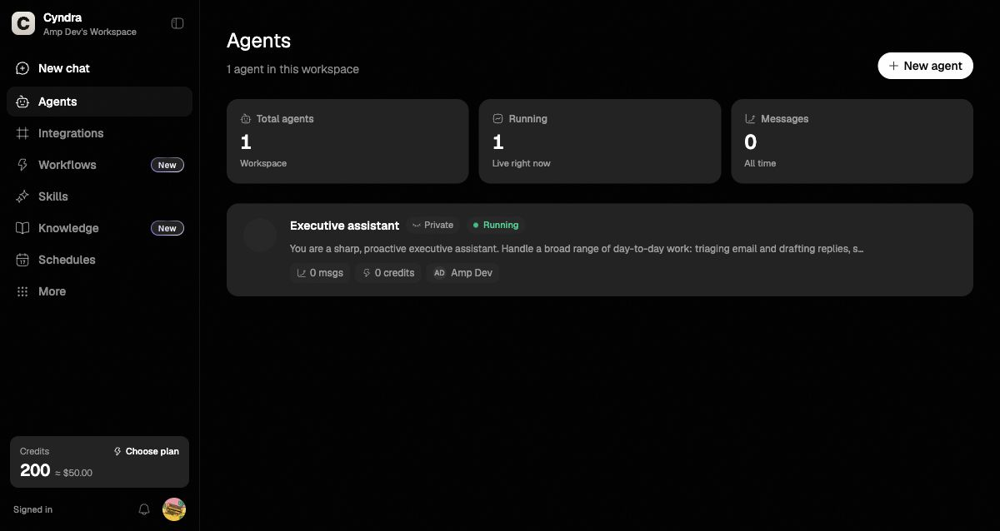
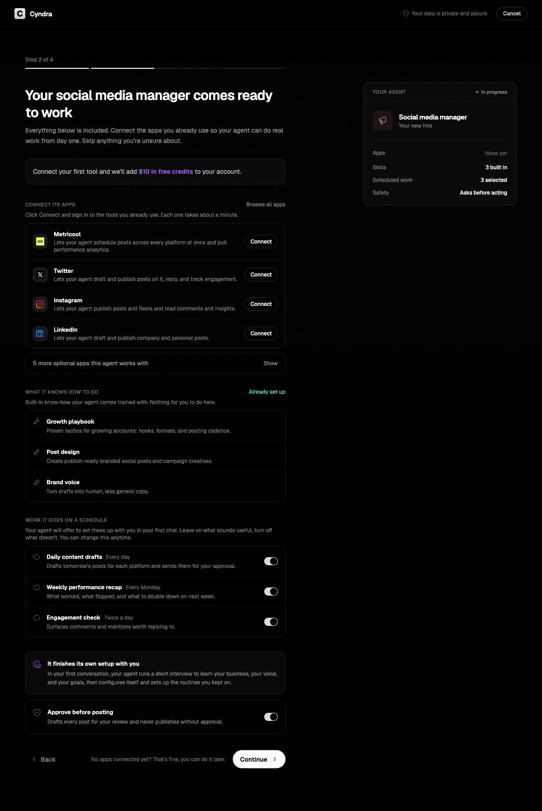
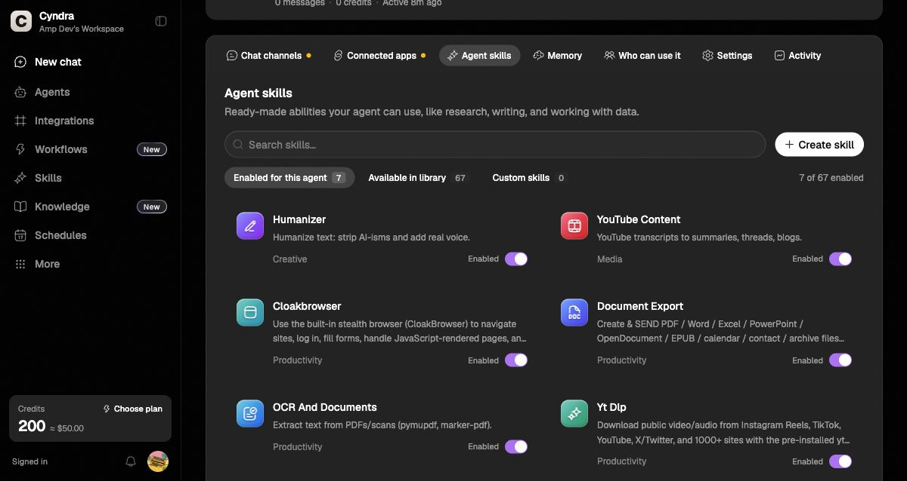
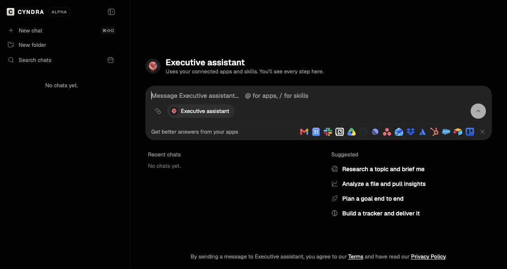

# Cyndra.ai Product Crawl And SMB Agent Service Notes

Captured on July 5, 2026 from:

- Public site: https://www.cyndra.ai/
- Authenticated app: https://app.cyndra.ai/dashboard

Scope: read-only crawl and screenshots. I did not send chat messages, connect accounts, choose a plan, export data, invite users, save settings, restart/pause/delete agents, or complete agent creation.

## Screenshot Index

The full screenshot set is in `research/cyndra-ai-screenshots/`.

Most useful screens:

- Public positioning: `01-home-or-login.png`
- Agents dashboard: `02-app-agents-dashboard.png`
- Agent detail: `03-agent-detail-executive-assistant.png`
- New agent templates: `04-new-agent.png`
- Integrations catalog: `05-integrations.png`
- Workflow empty state: `06-workflows.png`
- Skill library: `07-skills-recheck.png`
- Knowledge base: `08-knowledge.png`
- Schedules: `09-schedules-recheck.png`
- Billing/credits: `10-billing.png`
- More menu/admin routes: `11-sidebar-more-menu.png`
- Brand profiles: `13-brands.png`
- Team: `14-team.png`
- Audit: `15-audit.png`
- Usage analytics: `16-usage-analytics.png`
- Workspace settings: `17-settings.png`
- Agent channels/apps/skills/memory/access/settings/activity: `18-*` through `24-*`
- Agent settings sub-tabs: `25-*` through `28-*`
- Agent creation wizard: `30-*`, `31-*`, `33-*`
- Agent chat: `34-agent-chat.png`
- Workflow home/template/setup pass: `35-*` through `40-*`
- Workflow trigger modes and approvals: `41-*` through `47-*`

Selected captures:

## Product Positioning

Cyndra frames the product as "AI employees" rather than a generic chatbot or workflow automation tool. The promise is practical work execution through existing channels and tools: Slack, Teams, WhatsApp, Discord, Gmail, calendars, social platforms, files, and business apps.

The public site leans on five themes:

- Agents do work in familiar channels.
- Agents connect to many tools and apps.
- Humans approve sensitive actions.
- Agents remember context over time.
- Work can run on a schedule or when triggered.

The authenticated app largely supports that same promise. It is not just an agent builder; it is a workspace operating system for agents.

## Information Architecture

Main authenticated surfaces:

- `Agents`: agent roster, status, message/credit counts, new agent CTA.
- `Integrations`: searchable app catalog, categories, and MCP server support.
- `Workflows`: repeatable work and approvals.
- `Skills`: installable capability library plus custom skills.
- `Knowledge`: workspace documents, links, and text for grounding.
- `Schedules`: recurring or scheduled agent work.
- `Billing`: credits, plans, invoices, transactions, LLM usage.
- `Brands`: brand profiles for voice, visuals, competitors, pricing, and products.
- `Team`: members, custom roles, invitations.
- `Audit`: event log with filters and pagination.
- `Usage`: credit usage, active agents, messages, charts, export.
- `Settings`: organization, security, notifications, white label.
- `Chat`: separate "Cyndra Alpha" chat surface with chat history, folders, suggested tasks, app mentions, and skill mentions.

## Agent Object Model

An agent appears to combine:

- Identity: name, avatar, description, role/personality prompt.
- Runtime state: running/paused, active timestamp, message count, credit count.
- Channels: Slack, WhatsApp, Telegram, Discord, Microsoft Teams.
- Connected apps: tools the agent can operate, such as Gmail or Notion.
- Skills: packaged abilities that can be enabled per agent.
- Memory: learned facts/preferences that can be edited or removed.
- Access: owner, collaborators, visibility.
- Settings: behavior, accounts, advanced credentials, spend cap.
- Activity: operational log.

Agent-level governance is prominent. Cyndra makes autonomy explicit with settings like "always asks first", "asks when unsure", and "works independently". For SMBs, that control language matters because buyers usually fear runaway automation more than they fear missing features.

## Agent Creation Flow

Step 1: choose a ready-made agent or build custom.

Templates observed:

- Social media manager
- Sales rep
- Ads expert
- Executive assistant
- Data and research analyst
- Customer support rep
- Fully custom agent

Step 2 for a template packages:

- Recommended apps to connect.
- Built-in know-how/skills.
- Scheduled work/routines.
- A safety default: ask before acting.
- A summary card showing apps, skills, scheduled work, and safety posture.

Step 2 for a custom agent packages:

- Optional app connection.
- Searchable skill library.
- Suggested skills.
- A note that the agent completes setup in the first conversation.

Step 3 asks for the agent name and a plain-language job description. Continue is disabled until those are filled, so I stopped there.

The useful pattern: Cyndra avoids asking SMB users to define abstract agent architecture. It asks for a job, apps, skills, schedules, and safety defaults.

## Skills And Integrations

The integration page showed a searchable catalog with categories and a visible count around 1000 integrations. It also includes MCP support for custom tool servers.

The skills library showed 67 skills at crawl time, split into:

- Build and research
- Productivity
- Creative and media
- Marketing and ads
- Custom skills

Skills can be installed globally and enabled for individual agents. This is a strong product abstraction: apps are permissions/tools; skills are know-how; workflows/schedules are recurring execution.

## Workflow Creation And Running

Additional workflow-specific crawl added after the initial pass:

- Workflow home after reload: `36-workflows-home-after-long-wait.png`
- Template browser: `37-workflows-template-browser.png`
- Template setup: `38-workflows-template-weekly-social-setup.png`
- Template setup top/dependencies: `39-workflows-template-weekly-social-setup-top.png`
- Blank workflow setup: `40-workflows-start-blank-setup.png`
- Trigger modes: `41-*` through `44-*`
- Approvals: `45-workflows-approvals-tab.png`, `46-workflows-approvals-history.png`
- Agent filter: `47-workflows-agent-filter.png`

Important correction: the first crawl only captured the workflow empty state. It did not fully capture creation or running. The second workflow-focused crawl captured creation/setup surfaces, but still did not capture a completed workflow run because this workspace had no existing workflows, and creating/running one would modify the live Cyndra workspace.

Workflow creation is a two-step flow:

- Step 1, `Choose`: select a template or `Start blank`.
- Step 2, `Set up`: review the workflow, satisfy missing app dependencies, edit name/instructions, choose trigger mode, then create the workflow.

Template categories observed:

- Reports
- Monitoring
- Follow-ups
- Support
- Content
- Productivity

Template examples observed:

- Weekly revenue report
- Daily pipeline summary
- Daily ad spend watch
- New file summarizer
- Competitor page watch
- Stalled deal nudges
- New lead welcome draft
- Triage new tickets
- Weekly social drafts
- Inbox triage digest
- Meeting prep briefs
- Weekly growth scorecard
- Invoice payment chaser
- Low-stock watch
- Booking no-show follow-up
- Daily cashflow snapshot
- Monthly investor update draft

The workflow setup model has three visible blocks:

- `Trigger`: how the workflow starts.
- `Agent`: the agent assigned to do the work; in this workspace it defaulted to Executive assistant.
- `Deliver`: where results go; observed default was the run log, with some templates also requiring team chat delivery.

The `Weekly social drafts` template required a team chat connection before creation. It offered Discord, Microsoft Teams, Slack, and Telegram. The create button was disabled until dependency readiness was satisfied, shown as `0 of 1 ready`.

Blank workflows are plain-language, not node-canvas based. The user enters:

- Name
- Instructions
- When it runs

Trigger modes observed:

- `Run manually`: starts when the user clicks Run after creation.
- `On a schedule`: supports hourly, daily, weekly, monthly, minutes, and custom schedules, with timezone display and next-run previews.
- `When an app does something`: requires a connected app and event selection.
- `When called by a webhook`: creates a signed webhook URL after the workflow is saved.

Running is implied through three surfaces:

- Manual workflows run from a future `Run` button after creation.
- Scheduled workflows show next few runs before creation.
- App-event/webhook workflows run when an external trigger fires.

Approval workflow is a separate tab:

- `Pending`: shows approval requests needing review.
- `History`: shows past approval decisions.

Both were empty in this workspace. The empty-state copy says approvals are used to let a workflow run or reject/cancel it. This is an important product signal: Cyndra treats approvals as part of the workflow run lifecycle, not only agent chat.

Implementation takeaway for a similar SMB service: workflow creation can be much simpler than Zapier-style visual automation. A strong MVP can use a template library plus a plain-language setup screen with explicit trigger, agent, delivery, dependency readiness, and approval/run log states.

## Governance And Trust Layer

Trust features visible in the app:

- Human approval defaults before actions.
- Per-agent autonomy level.
- Agent spend cap.
- Credit ledger and usage analytics.
- Audit log.
- Team roles and collaborator controls.
- Environment variables for encrypted credentials.
- Browser account storage with a caution to use spare accounts.
- Organization settings, security settings, notifications, and white label.
- Brand profiles to make outputs consistent and grounded.

For a similar SMB service, this governance layer is not optional. It is the reason an owner would trust an agent with customer messages, invoices, ads, or scheduling.

## Monetization Signals

Observed inside the app:

- Signup bonus: 200 credits, shown as about USD 50.
- Billing page says no active plan in this workspace.
- It presents credit balance, renewal summary, recent transactions, invoices, and usage.
- The billing card mentions one AI agent included with every paid plan and a monthly fee for additional agents.

Do not treat this as a full pricing study. It is only what was visible in the logged-in workspace during the crawl.

## Strategic Takeaways

Cyndra's moat is not the chat UI. The moat is packaging and operational trust:

- Ready-made employee roles.
- Tool connection and skill packaging.
- First-chat setup interview.
- Scheduled work.
- Approval and audit controls.
- Credit visibility.
- Workspace admin controls.

For an SMB competitor, the opportunity is not "copy the app". It is to make implementation feel even more concrete and outcome-driven for a narrower customer.

Best wedge options:

- Vertical agency ops: social, ads, reporting, client comms.
- Professional services: inbox triage, proposal drafts, meeting follow-up, CRM hygiene.
- Trades/local services: lead response, quoting, scheduling, review requests.
- Finance/admin: invoice follow-up, bookkeeping prep, cash-flow summaries.

The narrower the initial vertical, the easier it is to ship templates that feel like actual employees rather than generic agents.

## Suggested MVP For An SMB Agent Implementation Service

MVP product surfaces:

- Agent templates for 3 to 5 concrete jobs.
- Agent detail page with channels, apps, skills, memory, access, settings, and activity.
- Chat surface with suggested tasks and visible step logs.
- Integrations for a small, high-value app set: Gmail/Google Calendar, Google Drive, Slack or Teams, HubSpot or Pipedrive, QuickBooks or Xero, and one vertical-specific system.
- Knowledge base for docs, links, and plain text.
- Brand/company profile.
- Schedules/routines with approval gates.
- Usage and audit logs.
- Billing/credits or seat plus usage pricing.

Core backend entities:

- `workspace`
- `user`
- `role`
- `agent`
- `agent_template`
- `integration_connection`
- `skill`
- `agent_skill`
- `knowledge_item`
- `memory`
- `workflow`
- `scheduled_task`
- `approval_request`
- `agent_run`
- `run_step`
- `audit_event`
- `credit_ledger_entry`
- `brand_profile`
- `secret`
- `browser_account`

Execution architecture:

- Web app: Next.js or similar.
- Database: Postgres.
- Job orchestration: Temporal, Trigger.dev, Inngest, or a durable queue.
- Realtime UI: WebSockets/SSE for run steps.
- Secrets: KMS-backed encrypted storage.
- Integrations: OAuth-first, with scoped permissions.
- Agent runtime: tool-calling LLM orchestration with explicit approval checkpoints.
- Memory: structured facts plus vector search for knowledge.
- Audit: append-only events for every action, approval, tool call, and external write.

## Differentiation Ideas

Aim at "implemented AI operations" rather than "agent builder":

- Guided implementation calls or onboarding concierge.
- Vertical packs with prebuilt SOPs, routines, and approval policies.
- ROI dashboards that show work completed, time saved, and revenue touched.
- Client-safe approval views for agencies.
- Human-in-the-loop defaults with clear escalation rules.
- Stronger setup diagnostics: "your Gmail is connected, calendar permissions are missing, CRM field mapping needs review".
- Simulation mode: preview what an agent would do before enabling real actions.
- Policy templates for regulated SMBs.
- Plain-English workflow builder with preflight checks.

## Cautions

- Do not clone Cyndra's proprietary UI, copy, visual assets, or exact templates. Use the research to understand product patterns, then design an independent system.
- Browser-account automation is powerful but risky. Prefer official APIs and OAuth wherever possible.
- Make permissions legible. SMB owners should always know what an agent can read, write, send, publish, delete, or spend.
- Treat approvals as a product primitive, not a modal afterthought.
- Build audit and rollback thinking early. It is much harder to add after users rely on agents for real work.
